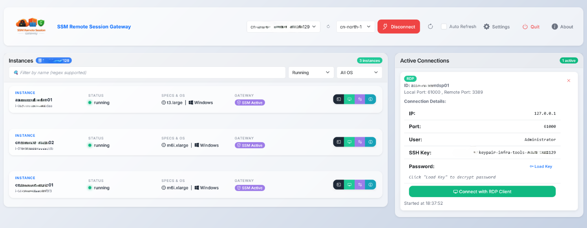

# SSM Remote Session Gateway

> Secure EC2 instance remote connection gateway — written in Rust with Axum and Bootstrap.

[](LICENSE)



---

## 🚀 Overview

SSM Remote Session Gateway simplifies access to EC2 instances and RDS databases without opening SSH ports or managing VPNs. The backend is now a Rust/Axum server that serves the existing static frontend and `/api/*` endpoints.

### Why SSM Remote Session Gateway?

- ✅ **Zero Open Ports** - No need to expose SSH ports or manage security groups
- ✅ **Secure by Default** - Uses AWS SSM Session Manager for encrypted connections
- ✅ **Sovereign Regions** - Full support for AWS China, GovCloud, and Sovereign Clouds
- ✅ **Cross-Platform** - Works seamlessly on Windows, macOS, and Linux
- ✅ **Auto-Discovery** - Automatically identifies AWS account IDs and aliases
- ✅ **Multi-Profile Support** - Switch between AWS profiles and regions effortlessly
- ✅ **Auto Key Detection** - Finds and uses SSH keys for password decryption
- ✅ **Persistent Session** - Remembers your last used profile and region

---

## ✨ Features

### Core Capabilities

- **🔐 SSH Connections**  
  Secure shell access via SSM port forwarding with automatic SSH key detection and path resolution

- **🖥️ RDP Support**  
  Remote desktop connections for Windows instances with automatic password decryption using SSH keys

- **🔌 Custom Port Forwarding**  
  Forward any port through SSM tunnels with flexible port selection and automatic port management

- **📊 Instance Management**
  View, filter, and manage EC2 instances with real-time status updates, OS/state filters, and comprehensive instance details

- **🗄️ RDS Database Support**
  Connect to RDS databases (MySQL, PostgreSQL, Aurora, etc.) via EC2 port forwarding with automatic database discovery and routing

- **🔑 Multi-Directory SSH Keys**  
  Support for multiple SSH key directories with automatic key lookup and path resolution

- **⚡ Auto-Refresh**  
  Automatic instance list refresh with configurable intervals

- **📦 Persistent Instance Cache**  
  Instance lists are cached per profile/region on disk with a configurable TTL (default 1h) to speed up repeat loads

- **🖥️ RDP Everywhere**  
  Launch RDP clients natively on Windows/macOS/Linux, and automatically fall back to Windows mstsc via WSL when native Linux clients are missing

- **🛑 One-Click Quit**  
  Quit button cleanly terminates active SSM port-forward sessions, shuts down the backend server, and closes the browser tab

- **🔍 Rich Active Connections**  
  Active connections panel shows SSH/RDP details, copyable commands, and quick “Open RDP” launcher per connection

- **🎨 Modern UI**  
  Clean, responsive interface built with Bootstrap 5

---

## 📋 Prerequisites

### System Requirements
- **Rust Toolchain** (1.93+ recommended)
- **[Session Manager Plugin](https://docs.aws.amazon.com/systems-manager/latest/userguide/session-manager-working-with-install-plugin.html)** (Required for SSM sessions)
- **AWS Credentials Profiles** (Configured in `~/.aws/credentials` and `~/.aws/config`)

### AWS Infrastructure Requirements
- **SSM Agent**: Must be installed and running on the target EC2 instances.
- **IAM Instance Profile**: Instances must have a role with the `AmazonSSMManagedInstanceCore` policy (or equivalent) attached.

---

## 🛡️ IAM Permissions

The user/role running this gateway needs the following permissions:

- **SSM**: `ssm:StartSession`, `ssm:DescribeInstanceInformation`, `ssm:TerminateSession`
- **EC2**: `ec2:DescribeInstances`, `ec2:DescribeRegions`, `ec2:GetPasswordData`
- **RDS**: `rds:DescribeDBInstances` (optional, for RDS database discovery)
- **STS**: `sts:GetCallerIdentity` (to identify account ID)
- **IAM**: `iam:ListAccountAliases` (optional, to display account name)

---

## 🛠️ Build & Run

```bash
git clone https://github.com/bartleboeuf/ssm-remote-session-gateway.git
cd ssm-remote-session-gateway
cargo run
```

The server listens on `https://127.0.0.1:5000` and serves both the UI and `/api/*` endpoints.

---

## 🎮 Usage

Open `https://127.0.0.1:5000` in your browser. Frontend assets live under `src/static`, and the API is served under `/api/*`.

---

## 📁 Project Structure

```
ssm-remote-session-gateway/
├── src/
│   ├── main.rs            # Axum server entrypoint
│   ├── server.rs          # HTTP server, routing, and graceful shutdown
│   ├── handlers/          # API endpoint logic (AWS, connections, prefs)
│   ├── models.rs          # Data structures and persistent preferences
│   ├── state.rs           # Shared application state
│   ├── logging.rs         # Structured file + environment logging
│   └── static/            # Static web assets
│       ├── css/           # CSS stylesheets (Bootstrap + custom)
│       ├── js/            # SPA core logic (app.js)
│       ├── images/        # UI icons and assets
│       └── templates/     # HTML shell (index.html)
├── Cargo.toml             # Rust package configuration
├── Cargo.lock             # Dependency lockfile
├── README.md              # Project documentation
├── LICENSE                # MIT license
└── image/                 # Repository screenshots
```

---

## 🔧 Development

- Format: `cargo fmt`
- Lint/check: `cargo check`
- Build: `cargo build --release`

---

## 📦 Packaging

Build a release binary:
```bash
cargo build --release
```
Binary: `target/release/ssm-remote-session-gateway`.

---

### Quick Start Guide

1. **Connect to AWS**
   - Select your AWS profile from the dropdown
   - Choose the AWS region
   - Click "Connect"
   - View your EC2 instances and RDS databases in the lists

2. **Start a Connection**
   - **SSH**: Click the "SSH" button on an EC2 instance card
   - **RDP**: Click the "RDP" button on Windows EC2 instances
   - **Custom Port**: Click the "Port" button and specify remote/local ports
   - **RDS Database**: Click the "Connect" button on a database and select an EC2 instance to route through

3. **Manage Connections**
   - View active connections in the sidebar
   - Copy connection details to clipboard
   - Terminate connections when done

### Advanced Features

#### Instance Filtering
Use the filter box to search instances by:
- Instance name
- Instance ID
- Instance type
- Instance state
- Operating system

Supports **regular expressions** for advanced filtering.

#### Port Selection
- **SSH/RDP**: Automatically uses the same local port as remote port (22 for SSH, 3389 for RDP)
- **RDS**: Automatically detects the database port (3306 for MySQL/Aurora, 5432 for PostgreSQL, etc.)
- **Custom Ports**: Uses the same local port if available, otherwise falls back to configured range
- **Port Range**: Configurable in Preferences with a default of 61000-61100.

---

## ⚙️ Configuration

### Preferences

Preferences are stored in:
- **Linux/macOS**: `~/.config/ssm-remote-session-gateway/preferences.json`
- **Windows**: `%APPDATA%\ssm-remote-session-gateway\preferences.json`

#### Available Settings

| Setting | Description | Default |
|---------|-------------|---------|
| **Port Range** | Port range for port forwarding | OS-specific (Windows: 40000-40100, Linux/macOS: 61000-61100) |
| **SSH Key Folders** | Directories where SSH keys are stored (one per line) | `~/.ssh` |
| **Logging Level** | Application log level | INFO |
| **Cache TTL (secs)** | Duration to reuse cached instance lists per profile/region | 3600 |

#### SSH Key Configuration

Configure multiple SSH key directories in Preferences:
- Each folder path on its own line
- Supports `~` expansion (e.g., `~/.ssh`)
- Keys are automatically searched when decrypting Windows passwords
- SSH commands include the key path automatically

**Example:**
```
~/.ssh
~/Projects/keys
/path/to/custom/keys
```
---

## 🐛 Troubleshooting

### Common Issues

<details>
<summary><b>AWS CLI not found</b></summary>

**Solution:** Install AWS CLI v2 and ensure it's in your PATH.

Verify installation:
```bash
aws --version
```
</details>

<details>
<summary><b>Session Manager Plugin missing</b></summary>

**Solution:** Install the AWS Session Manager Plugin.

Verify installation:
```bash
session-manager-plugin
```
</details>

<details>
<summary><b>No AWS credentials detected</b></summary>

**Solution:** Configure AWS credentials via `aws configure` or environment variables.

```bash
aws configure
# or set environment variables:
export AWS_ACCESS_KEY_ID=your_access_key
export AWS_SECRET_ACCESS_KEY=your_secret_key
export AWS_DEFAULT_REGION=us-east-1
```
</details>

<details>
<summary><b>Port already in use</b></summary>

**Solution:** Adjust port range in Preferences or specify a different local port when starting a connection.
</details>

<details>
<summary><b>EC2 Instance not appearing in the list</b></summary>

**Solutions:**
- Ensure the instance is in the region you selected.
- Verify the **SSM Agent** is installed and running on the instance.
- Confirm the instance has an **IAM Instance Profile** with the `AmazonSSMManagedInstanceCore` policy.
- Check if the instance has network access to the SSM endpoints (e.g., via NAT gateway or VPC Endpoints).
</details>

<details>
<summary><b>SSH key not found for RDP password decryption</b></summary>

**Solutions:**
- Ensure your instance has a key pair attached and you know the key name.
- Add the key directory to Preferences (Settings -> SSH Key Folders), one path per line.
- Provide the PEM contents directly when prompted.

</details>

---

## 📝 License

MIT License. See `LICENSE` for details.

---

## 🎯 Roadmap

- [ ] Improve instances retrieval algorithm
- [ ] Enhanced connection history
- [ ] Connection templates/presets
- [ ] Batch operations on instances
- [ ] Export connection details
- [ ] Dark mode support

---

## 🙏 Acknowledgments

This project was inspired by [SSM Manager](https://github.com/mauroo82/ssm-manager), a Windows desktop application for managing AWS SSM sessions. SSM Remote Session Gateway extends this concept with cross-platform support and additional features.

---

**Made with ❤️ for the AWS community**
